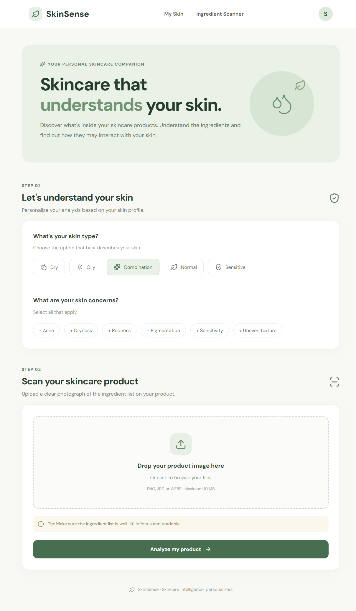
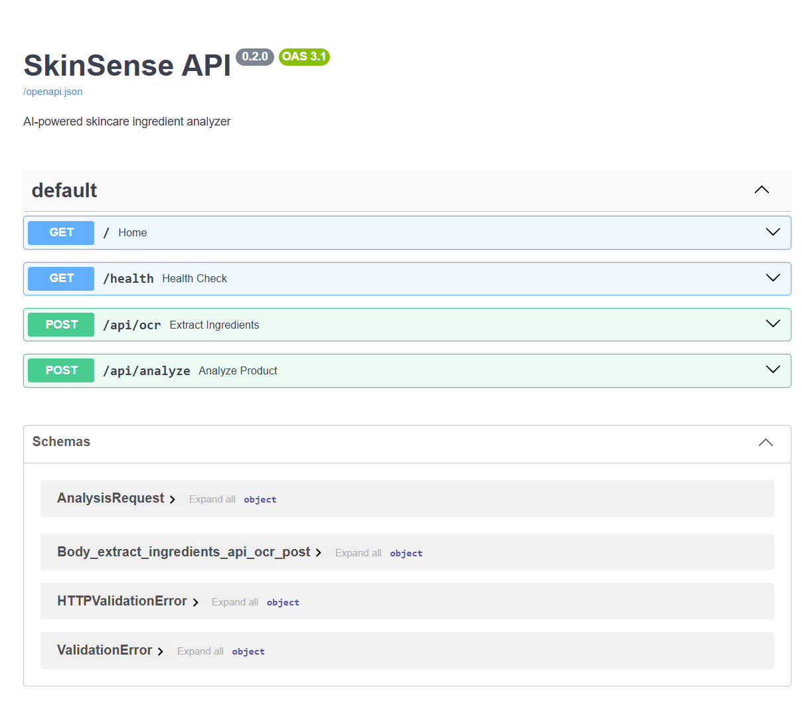
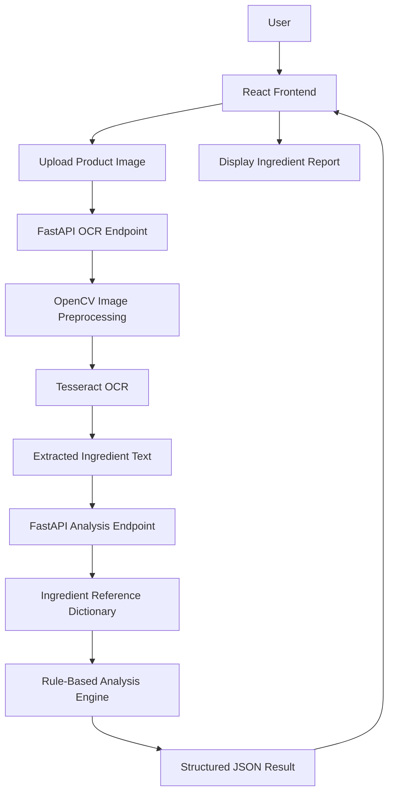

# 🌿 SkinSense — Skincare Ingredient Analyzer

**Understand what's inside your skincare products.**

SkinSense is a web-based skincare ingredient analyzer that uses Optical Character Recognition (OCR) to extract ingredient lists from product-label images and provides ingredient insights based on a user's selected skin type and concerns.

The project combines a React frontend with a Python FastAPI backend, an OCR pipeline, and a rule-based ingredient analysis engine.

> **Current status:** Working MVP — image upload, OCR extraction, ingredient analysis, and frontend/backend integration are implemented. AI-based interpretation and a comprehensive ingredient database are planned future enhancements.

---

## ✨ Features

- **📷 Ingredient Label Scanning** — Upload an image of a skincare product's ingredient list.
- **🔎 OCR Text Extraction** — Extract ingredient text using Tesseract OCR.
- **🖼️ Image Preprocessing** — Improve text readability using OpenCV.
- **🧴 Skin Profile Selection** — Select a skin type such as Dry, Oily, Combination, Normal, or Sensitive.
- **🎯 Skin Concerns** — Select concerns such as Acne, Dryness, Redness, Pigmentation, Sensitivity, and Uneven Texture.
- **📊 Ingredient Analysis** — Identify recognized ingredients and display their category, functions, potential benefits, assessments, and cautions.
- **⚠️ Potential Cautions** — Highlight ingredients that may warrant attention based on the current reference data and rules.
- **🖥️ Interactive Web Interface** — A React-based interface with image preview and analysis results.
- **🔌 REST API** — Backend endpoints built with FastAPI.
- **📑 Interactive API Documentation** — Test backend endpoints using Swagger UI.

---

## 🖼️ Application Preview

<!-- Add project screenshots here after capturing them -->

| SkinSense Interface | Ingredient Analysis |
|  |  |


---

## 🛠️ Tech Stack

### Frontend
- React
- JavaScript
- Vite
- CSS
- Lucide React

### Backend
- Python
- FastAPI
- Pydantic

### Image Processing & OCR
- OpenCV
- Tesseract OCR
- pytesseract
- NumPy

### Development Tools
- Git & GitHub
- Visual Studio Code
- Swagger UI / OpenAPI

---

## 🏗️ System Architecture



### Workflow

1. The user selects their skin type and skincare concerns.
2. The user uploads an image of a product's ingredient label.
3. The frontend sends the image to the backend OCR endpoint.
4. The backend preprocesses the image to improve text recognition.
5. Tesseract OCR extracts the visible text from the image.
6. The extracted text is sent to the ingredient-analysis endpoint along with the selected skin profile.
7. The analysis engine matches recognized ingredients against its reference dictionary.
8. Predefined rules generate ingredient assessments and potential cautions.
9. The backend returns a structured JSON response.
10. The frontend displays the ingredient analysis to the user.

---

## 🧠 How Ingredient Analysis Works

The current MVP uses a **rule-based approach** rather than a trained machine-learning model or a generative AI model.

### 1. Ingredient Reference Data

The project maintains a local ingredient reference dictionary containing information about selected ingredients, including:

- Ingredient name
- Category
- Functions
- Potential benefits
- Skin-related assessments
- Potential cautions

### 2. Ingredient Matching

The analyzer searches the OCR-extracted text for ingredients recognized by its reference data and matching logic.

### 3. Rule-Based Assessment

Predefined rules use the recognized ingredient information and the user's selected skin profile to generate the assessment.

### 4. Structured Results

The analysis is returned as JSON containing recognized ingredients, their properties, potential cautions, and other analysis information consumed by the frontend.

### Why a Rule-Based MVP?

The initial development focused on implementing and validating the complete application workflow—from image upload and OCR to ingredient analysis and frontend display.

A rule-based engine offers:

- Predictable output
- Explainable logic
- Easier debugging
- Lightweight implementation
- A foundation for testing and future improvements

A comprehensive ingredient database and AI-based interpretation are planned enhancements rather than features currently integrated into the MVP.

---

## 🔌 API Endpoints

The backend exposes the following endpoints:

| Method | Endpoint | Description |
|---|---|---|
| `GET` | `/` | Basic API welcome/status response |
| `GET` | `/health` | Health check |
| `POST` | `/api/ocr` | Upload an image and extract ingredient text |
| `POST` | `/api/analyze` | Analyze extracted ingredient text using the selected skin profile |

### Interactive API Documentation

Once the backend is running, access:

- **Swagger UI:** `http://127.0.0.1:8000/docs`
- **OpenAPI Schema:** `http://127.0.0.1:8000/openapi.json`

Swagger UI can be used to test the backend independently of the frontend.

---

## 🚀 Getting Started

Follow these instructions to run SkinSense locally.

### Prerequisites

Install the following:

- Python 3.10+
- Node.js and npm
- Git
- Tesseract OCR
- Visual Studio Code (recommended)

---

### 1. Clone the Repository

```bash
git clone https://github.com/YOUR-USERNAME/SkinSense.git
cd SkinSense
```

Replace `YOUR-USERNAME/SkinSense` with your actual repository URL if needed.

---

### 2. Set Up the Backend

Navigate to the backend directory:

```bash
cd backend
```

Create a Python virtual environment:

```bash
python -m venv venv
```

Activate it on Windows:

```bash
venv\Scripts\activate
```

Activate it on macOS/Linux:

```bash
source venv/bin/activate
```

Install the dependencies:

```bash
pip install -r requirements.txt
```

---

### 3. Install Tesseract OCR

SkinSense uses Tesseract OCR to recognize ingredient text from uploaded images.

On Windows, install Tesseract OCR and ensure its executable is accessible.

If Tesseract is installed in the default location, the backend may use:

```text
C:\Program Files\Tesseract-OCR\tesseract.exe
```

If it is installed elsewhere, update the Tesseract executable path configured in the backend.

Verify the installation:

```bash
tesseract --version
```

---

### 4. Start the Backend

From inside the `backend` directory, run:

```bash
uvicorn app:app --reload
```

The backend will be available at:

```text
http://127.0.0.1:8000
```

Open the interactive API documentation:

```text
http://127.0.0.1:8000/docs
```

---

### 5. Set Up the Frontend

Open a **second terminal** from the project root.

Navigate to the frontend directory:

```bash
cd frontend
```

Install frontend dependencies:

```bash
npm install
```

Start the development server:

```bash
npm run dev
```

The frontend will usually be available at:

```text
http://localhost:5173
```

---

## 📁 Project Structure

```text
SkinSense/
│
├── backend/
│   ├── app.py
│   ├── analyzer.py
│   ├── ingredient_data.py
│   ├── requirements.txt
│
├── frontend/
│   ├── public/
│   ├── src/
│   │   ├── App.jsx
│   │   ├── App.css
│   │   ├── index.css
│   │   └── main.jsx
│   ├── package.json
│   └── .gitignore
│
├── Dockerfile
├── .gitignore
└── README.md
```

---

## 🧪 Testing

### Backend Testing

Backend endpoints can be tested through Swagger UI:

```text
http://127.0.0.1:8000/docs
```

Test the OCR endpoint by uploading an ingredient-label image and checking the extracted text.

Test the analysis endpoint by supplying extracted ingredient text, a skin type, and selected concerns, then verify the returned JSON.

### Frontend Testing

Run the frontend and backend simultaneously and test the complete workflow:

1. Select a skin type.
2. Select one or more skin concerns.
3. Upload an ingredient-label image.
4. Preview the image.
5. Run the analysis.
6. Review the extracted text.
7. Review the ingredient report and potential cautions.

---

## ⚠️ Limitations

SkinSense is currently an MVP and has several limitations:

- The ingredient reference dictionary covers only selected ingredients.
- OCR accuracy depends on image quality, lighting, label formatting, and text readability.
- OCR may misread ingredient names or fail to extract some text.
- Ingredient matching may not recognize all synonyms, spelling variations, or unfamiliar ingredients.
- The current analysis is rule-based and does not use a trained ML model or generative AI.
- The analyzer does not account for every ingredient concentration, formulation interaction, or individual skin response.
- The results are informational and should not be treated as medical advice or a definitive assessment of product safety.

Users should verify extracted ingredient text against the original product label.

---

## 🔮 Future Improvements

- [ ] Expand the ingredient reference dictionary.
- [ ] Integrate a verified cosmetic ingredient database.
- [ ] Improve ingredient normalization and synonym matching.
- [ ] Improve OCR accuracy for difficult labels.
- [ ] Handle unknown ingredients more effectively.
- [ ] Add source-backed ingredient information.
- [ ] Introduce AI-assisted explanations grounded in retrieved reference information.
- [ ] Add product comparison functionality.
- [ ] Add scan history and user accounts.
- [ ] Improve responsive design and accessibility.
- [ ] Deploy the frontend and backend for public access.
- [ ] Add automated tests for OCR, ingredient matching, and API endpoints.

---

## 🎯 Project Objective

The goal of SkinSense is to make skincare ingredient lists easier to understand by combining image-based text extraction with accessible ingredient information and skin-profile-based analysis.

The project also serves as an exploration of full-stack development, API integration, computer vision, OCR, image preprocessing, and the design of explainable analysis systems.

---

## 👩‍💻 Author

**Your Name**

- GitHub: [Aditi-svg7](https://github.com/Aditi-svg7)
- LinkedIn: [Aditi Singh](www.linkedin.com/in/aditi-singh-a7b24a342)

---

## 📄 Disclaimer

SkinSense is an educational software project and is not a medical or dermatological diagnostic tool.

Ingredient assessments are based on limited reference data and predefined rules. Individual reactions to skincare products can vary. Always verify product labels and consult a qualified healthcare professional regarding medical or skin-related concerns.

---

⭐ If you find this project interesting, feel free to explore the repository and suggest improvements.

